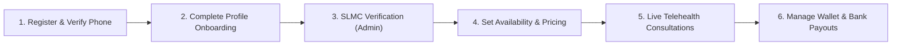

# HITHA DOCTOR APP (PRACTITIONER PORTAL) — MASTER AGENT SPECIFICATION & ARCHITECTURE GUIDE

> **Source Specification Reference:** `D:\HITHA\hitha-agent-context\DOCTOR-FLOW`  
> **Platform & Framework:** Flutter 3.47+ / Dart 3.10+  
> **Companion Application:** Hitha Patient App (`hitha_telehealth`)  

This document is the **authoritative, single-source-of-truth agent instruction file (`AGENT.md`)** for developing the **Hitha Doctor App (Practitioner Portal)**. 

Any AI agent or developer implementing the Doctor App must adhere **100% to the exact same architectural pattern (Clean Architecture + Feature-First MVVM), tech stack, libraries, design system, theme tokens, and coding conventions** used in the Patient App, while implementing the complete business flows and API endpoints defined in `hitha-agent-context/DOCTOR-FLOW`.

---

## 1. PROJECT SCOPE & PRACTITIONER LIFECYCLE

The Hitha Doctor App serves certified Sri Lankan mental health professionals registered with the **Sri Lanka Medical Council (SLMC)**.

### The 6 Core Phases (Doctor Lifecycle):


### Supported Practitioner Categories:
1. `COUNSELOR` (උපදේශක / ஆலோசகர்) — Base: LKR 2,500
2. `CLINICAL_COUNSELOR` (සායනික උපදේශක / மருத்துவ ஆலோசகர்) — Base: LKR 3,000
3. `PSYCHOLOGIST` (මනෝවිද්‍යාඥ / உளவியலாளர்) — Base: LKR 3,500
4. `CLINICAL_PSYCHOLOGIST` (සායනික මනෝවිද්‍යාඥ / மருத்துவ உளவியலாளர்) — Base: LKR 4,000
5. `MEDICAL_OFFICER_PSYCHIATRY_DIPLOMA` (වෛද්‍ය නිලධාරී - මනෝ වෛද්‍ය) — Base: LKR 4,500
6. `CONSULTANT_PSYCHIATRIST` (විශේෂඥ මනෝ වෛද්‍ය / மனநல ஆலோசகர்) — Base: LKR 5,000

---

## 2. ARCHITECTURAL PATTERN: CLEAN ARCHITECTURE + FEATURE-FIRST MVVM

The project is structured with strict layering:

```
┌─────────────────────────────────────────────────────────────────────────────┐
│                             PRESENTATION LAYER                              │
│   • Views: Screens & Widgets (StatelessWidget / Stateful / Consumer)        │
│   • ViewModels: State management via ChangeNotifier                         │
└──────────────────────────────────────▲──────────────────────────────────────┘
                                       │
┌──────────────────────────────────────┴──────────────────────────────────────┐
│                                DOMAIN LAYER                                 │
│   • Pure Immutable Data Models (const constructors, final fields)           │
│   • Domain Enums (DoctorCategory, BookingStatus, AppLanguage, etc.)         │
└──────────────────────────────────────▲──────────────────────────────────────┘
                                       │
┌──────────────────────────────────────┴──────────────────────────────────────┐
│                                 DATA LAYER                                  │
│   • Repositories: Single Source of Truth for each feature                   │
│   • Services: ApiClient (JWT token lifecycle, 401 refresh, envelope)       │
│   • Persistence: FlutterSecureStorage (Keystore/Keychain)                   │
│   • Demo Simulation: SampleData fallback when HITHA_DEMO=true               │
└─────────────────────────────────────────────────────────────────────────────┘
```

### Core Architecture Rules:
1. **Zero HTTP in Views:** Views must never make network calls or import `http`/`ApiClient`. All interaction occurs through the feature's `ViewModel`.
2. **ViewModel Responsibility:** A ViewModel extends `ChangeNotifier`, holds state variables, provides getters, performs async repository operations, and calls `notifyListeners()`.
3. **Repository Responsibility:** Repositories convert raw JSON maps to Domain Models, handle caching, and toggle between `ApiClient` and `SampleData` (based on `AppConfig.demoMode`).
4. **Universal API Envelope:** All backend endpoints return `{success, status, message, data, pagination, errors}`. `ApiClient` unwraps the envelope and returns `data` or throws `ApiException`.

---

## 3. DEPENDENCIES & LIBRARIES (`pubspec.yaml`)

Use the **exact same dependency suite** as the patient app:

```yaml
name: hitha_doctor_app
description: "Hitha Telehealth Practitioner Mobile Application."
publish_to: 'none'
version: 1.0.0+1

environment:
  sdk: ^3.10.1

dependencies:
  flutter:
    sdk: flutter

  # State Management & Dependency Injection
  provider: ^6.1.5+1

  # Declarative Routing & Shell Navigation
  go_router: ^17.5.0

  # REST API Client
  http: ^1.6.0

  # Hardware-backed Secure Token Storage (Keystore / Keychain)
  flutter_secure_storage: ^11.2.0

  # Typography (Plus Jakarta Sans & JetBrains Mono)
  google_fonts: ^8.2.1

  # Date, Time & LKR Currency Formatting
  intl: ^0.20.3

  # In-App Browser & WebRTC WebView
  webview_flutter: ^4.14.1

  # System Intents (Phone dialer 1926, external URLs)
  url_launcher: ^6.3.2

  # Document handling & Prescription storage
  file_picker: ^13.1.0
  path_provider: ^2.1.6

dev_dependencies:
  flutter_test:
    sdk: flutter
  flutter_lints: ^6.0.0

flutter:
  uses-material-design: true
  assets:
    - assets/images/
```

---

## 4. DESIGN SYSTEM & VISUAL TOKENS

The Doctor App shares the **exact same brand identity tokens** as the patient app (`hitha_theme.dart`):

### 4.1 Color Tokens (`HithaColors`)
```dart
abstract final class HithaColors {
  static const cream = Color(0xFFE8F6F1);
  static const creamLight = Color(0xFFF3FBF8);
  static const creamDark = Color(0xFFEDF1F0);
  static const hairline = Color(0xFFD3EAE4);
  static const forest = Color(0xFF0D3B66);
  static const forestDark = Color(0xFF082641);
  static const forestDeep = Color(0xFF061B30);
  static const forestHover = Color(0xFF0F4573);
  static const mint = Color(0xFF00A8B5);
  static const mintDark = Color(0xFF00838D);
  static const moss = Color(0xFF4CAF50);
  static const sprout = Color(0xFFD4ECD1);
  static const saffron = Color(0xFFD4A24C);
  static const clay = Color(0xFFB5533C);
  static const clayTint = Color(0xFFF4E2DD);
  static const ink = Color(0xFF0D3B66);
  static const inkSoft = Color(0xFF375D82);
  static const inkFaint = Color(0xFF7C97AF);
  static const slate300 = Color(0xFFCBD5E1);
  static const slate400 = Color(0xFF94A3B8);
}
```

### 4.2 Typography (`HithaText`)
- **Body & Headlines:** `GoogleFonts.plusJakartaSans()`
- **Monospace (SLMC IDs, Prices in LKR, Reference Codes, Time Windows):** `GoogleFonts.jetBrainsMono()`
- Hierarchy:
  - `hero`: 34pt, w800, tracking -0.68
  - `h1`: 26pt, w800, tracking -0.39
  - `h2`: 20pt, w700, tracking -0.2
  - `h3`: 16pt, w700
  - `body`: 14pt, w400, line-height 1.6
  - `bodyMedium`: 14pt, w500
  - `bodySmall`: 12.5pt, w400
  - `caption`: 11pt, w600

### 4.3 Corner Radii & Spacing
- `HithaRadius.card = 24.0`, `cardLg = 32.0`, `sub = 16.0`, `badge = 8.0`
- `HithaSpacing.page = 16.0`, `pageBottom = 80.0`

### 4.4 Reusable Components (`hitha_widgets.dart`)
- `HithaCard`: Bordered surface with subtle shadows and customizable padding.
- `PrimaryButton`: Filled forest/mint pill button with optional icon.
- `SecondaryButton` / `OutlineButton`: Subdued actions.
- `CaptionLabel`: Styled badge container with dot indicator.
- `HithaTextInput`: Custom styled form field with error display.
- `showHithaSnack(context, message)`: Consistent floating snackbar.

---

## 5. COMPLETE PROJECT DIRECTORY STRUCTURE

```
lib/
├── config/
│   ├── app_config.dart                  # HITHA_API_URL, HITHA_DEMO, crisisHotline
│   ├── routes.dart                      # Static route paths
│   └── router.dart                      # GoRouter with DoctorShell & Auth Guard
│
├── data/
│   ├── services/
│   │   ├── api_client.dart              # REST Client, Bearer token, auto refresh
│   │   └── sample_data.dart             # Mock doctor profile, slots, bookings, wallet
│   └── repositories/
│       ├── doctor_auth_repository.dart  # Sign-in, register, OTP verification, password reset
│       ├── profile_repository.dart      # Bio, credentials, SLMC status, complete profile
│       ├── schedule_repository.dart     # Weekly templates, custom slots, blocked dates
│       ├── bookings_repository.dart     # Appointment queue, patient dossier, session status
│       ├── meeting_repository.dart      # LiveKit room credentials, session notes, complete call
│       ├── prescription_repository.dart # Drug formulary search, digital prescription issue
│       ├── wallet_repository.dart       # Balance summary, bank accounts, withdrawal requests
│       ├── articles_repository.dart     # Doctor-authored wellness articles CRUD
│       └── json_mapping.dart            # Safe JSON decoders & parsers
│
├── domain/
│   └── models/
│       └── models.dart                  # DoctorProfile, AvailabilityWindow, BookingItem,
│                                        # Prescription, WalletSummary, BankAccount, etc.
├── ui/
│   ├── core/
│   │   ├── theme/
│   │   │   └── hitha_theme.dart         # HithaColors, HithaText, ThemeData
│   │   └── widgets/
│   │       └── hitha_widgets.dart       # HithaCard, PrimaryButton, HithaTextInput, etc.
│   │
│   └── features/
│       ├── auth/                        # 01-04: Login, Register, Phone OTP, Forgot Password
│       ├── onboarding/                  # 05: Complete Profile (Bio, Gender, Specs, Languages)
│       ├── dashboard/                   # 06: Practitioner KPI Overview, Active Queue, Online Switch
│       ├── schedule/                    # 06.5: Availability Calendar, Weekly Slots, Blocked Days
│       ├── pricing/                     # 06.6: Category pricing & Custom Fee Requests
│       ├── bookings/                    # 06.7: Consultation Queue, Patient Dossier & Details
│       ├── meeting/                     # 06.8: Live Telehealth Video/Audio Room (LiveKit WebRTC)
│       ├── clinical_notes/              # 06.9: Session Observations & Private Notes
│       ├── prescription_writer/         # 06.9: Drug Catalog Search & Prescription Builder
│       ├── wallet/                      # 06.3: Balance cards, Withdrawals, Bank Accounts, Ledger
│       ├── finance/                     # 06.2: Revenue Telemetry, Analytics, Consultation earnings
│       ├── articles/                    # 06.4: My Wellness Articles list & Draft Editor
│       └── shell/                       # DoctorShell with Bottom Navigation (Home, Schedule, Bookings, Wallet)
│
└── main.dart                            # Composition root (MultiProvider & MaterialApp.router)
```

---

## 6. END-TO-END DOCTOR FLOWS & SPECIFICATIONS

### Flow 01: Doctor Authentication & Password Recovery
- **Routes:** `/doctor/login`, `/doctor/forgot-password`
- **Behavior:**
  - Login via registered email or Sri Lankan phone number (`+9477...`) + password.
  - Returns `accessToken`, `refreshToken`, `role: "ROLE_DOCTOR"`, and `profileComplete`.
  - **Middleware Guard:**
    - If `profileComplete == false` $\rightarrow$ immediately redirect to `/doctor/complete-profile`.
    - If `profileComplete == true` $\rightarrow$ proceed to `/doctor/dashboard`.
  - Password recovery: `POST /auth/send-code` with `purpose: "PASSWORD_RESET"`, then `POST /doctor/forgot-password` with 6-digit OTP and new password.

### Flow 02: Doctor Self-Registration
- **Route:** `/doctor/register`
- **Fields:** First Name, Last Name, Email, Phone Number, Password, Category (Enum), SLMC License Number, Profile Picture URL, Certified SLMC Document URL.
- **Result:** Doctor account created in `UNVERIFIED` state; redirects to Phone OTP Verification.

### Flow 03 & 04: Phone OTP Verification
- **Route:** `/doctor/verify-phone`
- **Behavior:**
  - `POST /auth/send-code` with `identifier` and `purpose: "DOCTOR_LOGIN"`.
  - Doctor enters 6-digit OTP $\rightarrow$ `POST /auth/verify-code`.
  - Marks phone verified and directs doctor to complete profile.

### Flow 05: Profile Completion (Onboarding)
- **Route:** `/doctor/complete-profile`
- **Fields:** Professional Bio, Gender (`MALE` / `FEMALE`), Languages (at least one of `en`, `si`, `ta`), Qualifications list, Specialties list.
- **Result:** Transitions account status to `PENDING_VERIFICATION`. Doctor accesses dashboard with a banner: *"Account awaiting SLMC administrative approval"*.

### Flow 06: Practitioner Dashboard & Online Presence
- **Route:** `/doctor/dashboard`
- **Header:** Doctor name, SLMC badge, category, and real-time **Online Status Switch** (`ONLINE`, `BUSY`, `OFFLINE`) via `PATCH /doctors/status`.
- **KPI Metrics:**
  - Active Queue / Upcoming Consultations count.
  - Available Liquid Balance (`LKR XX,XXX`).
  - Escrow Balance (`LKR XX,XXX`).
- **Today's Patient Schedule:** Cards showing booking reference, patient name, duration, and `Start Patient Session` button.

### Flow 07: Availability & Slot Configuration Hub
- **Route:** `/doctor/availability`
- **4 Sub-Modules:**
  1. **Weekly Recurring Template (`/doctor/availability/weekly`):** Configure standard weekly hours (e.g. Mon 09:00 - 17:00, Wed 14:00 - 19:00) with `dayOfWeek` (1 = Monday, 7 = Sunday).
  2. **Custom Slots (`/doctor/availability/custom`):** One-off specific availability outside regular hours (`POST /doctors/availability/custom-slots`).
  3. **Blocked Days & Leave (`/doctor/availability/blocked`):** Mark full or partial days off (Poya days, holidays) with custom reason (`POST /doctors/blocked-dates`).
  4. **Calendar View (`/doctor/availability/calendar`):** View computed slot windows returned by `GET /doctors/availability`.

### Flow 08: Pricing & Overrides
- **Route:** `/doctor/pricing`
- **Behavior:**
  - Displays category default fee (e.g. LKR 4,000 for Clinical Psychologist).
  - Doctor can request a custom fee (`POST /doctors/price-requests`) with `requestedPriceLkr` and clinical justification.
  - Shows request status (`PENDING`, `APPROVED`, `REJECTED`).

### Flow 09: Consultation Directory & Patient Dossier
- **Routes:** `/doctor/bookings`, `/doctor/bookings/:id`
- **Filter Tabs:** `ALL`, `CONFIRMED`, `SLIP_UNDER_REVIEW`, `COMPLETED`, `PENDING_PAYMENT`, `CANCELLED`.
- **Dossier:** Patient name (or *"Anonymous Client"* if anonymous), contact details, previous session notes history (`GET /doctors/sessions/:id/patient-notes-history`).

### Flow 10: Live Telehealth Session (Video/Audio Room)
- **Route:** `/meeting/:bookingId`
- **Behavior:**
  - Doctor clicks "Join Session" $\rightarrow$ `POST /doctors/sessions/:id/join`.
  - Receives ephemeral LiveKit token, `roomName`, and `serverUrl` (`wss://livekit.hitha.lk`).
  - Connects to WebRTC room with camera/mic controls, participant indicators, and shared lab reports viewer (`GET /doctors/sessions/:id/documents`).
  - Doctor clicks "End Session" $\rightarrow$ `POST /session/:id/complete`.

### Flow 11: Clinical Notes & Digital Prescription Writer
- **Docked inside session or accessed post-call:**
  - **Clinical Notes (`POST /doctors/sessions/:id/notes`):** Structured form covering Chief Complaints, Observations/MSE, Clinical Impressions, Treatment Plan, and **Private Doctor Notes** (hidden from patient).
  - **Digital Prescription (`POST /doctors/sessions/:id/prescription`):**
    - Search drug formulary catalog: `GET /doctors/prescriptions/drugs/search?query=`.
    - Select drug, input dosage (e.g. `500mg`), frequency (e.g. `bd`), duration (e.g. `2 Weeks`), and instructions (e.g. *"After meals"*).
    - Submits prescription; backend generates PDF and alerts patient.

### Flow 12: Doctor Wallet, Finance & Bank Payouts
- **Routes:** `/doctor/wallet`, `/doctor/finance`
- **Balances:**
  - `balanceAvailable`: Cleared funds ready for withdrawal.
  - `balanceEscrow`: Held during ongoing/upcoming bookings.
  - `balancePendingPayout`: Currently processing bank transfers.
  - `balanceFrozen`: Disputed funds.
- **Bank Accounts:** Add Sri Lankan bank accounts (`POST /doctor/wallet/payout-methods`): Bank of Ceylon, Commercial Bank, HNB, Sampath Bank, etc.
- **Withdrawals:** Request payout (`POST /doctor/wallet/withdrawals`).
- **Ledger:** Transparent transaction ledger showing booking credits, platform commission deductions, and payout debits.

### Flow 13: Wellness Articles Authoring
- **Route:** `/doctor/blogs`
- **Behavior:** Doctors write and publish mental health blogs and advice for patients. Supports draft saving and submission for admin editorial review.

---

## 7. BACKEND API SPECIFICATION (EXACT SCHEMAS)

All API calls connect to:
- **Base URL:** `https://hitha-server.beetlecode.com/api/v1`
- **Authentication:** `Authorization: Bearer <accessToken>`

### 7.1 Authentication & Profile Endpoints
| Endpoint | Method | Auth | Payload / Description |
|---|---|---|---|
| `/doctor/login` | `POST` | Public | `{"identifier": "...", "password": "..."}` $\rightarrow$ returns JWT tokens & `profileComplete` |
| `/doctor/register` | `POST` | Public | `{"firstName": "...", "lastName": "...", "email": "...", "phoneNumber": "...", "password": "...", "category": "...", "slmcLicenseNumber": "..."}` |
| `/auth/send-code` | `POST` | Public | `{"identifier": "...", "purpose": "DOCTOR_LOGIN" \| "PASSWORD_RESET"}` |
| `/auth/verify-code` | `POST` | Public | `{"identifier": "...", "verificationCode": "123456"}` |
| `/doctor/forgot-password` | `POST` | Public | `{"identifier": "...", "verificationCode": "123456", "newPassword": "..."}` |
| `/auth/refresh` | `POST` | Public | `{"refreshToken": "..."}` $\rightarrow$ returns fresh `accessToken` |
| `/auth/logout` | `POST` | Bearer | `{"refreshToken": "..."}` $\rightarrow$ blacklists session |
| `/doctors/me` | `GET` | Bearer | Returns doctor profile, SLMC number, balances, active queue |
| `/doctors/me/complete-profile` | `POST` | Bearer | `{"professionalBio": "...", "gender": "FEMALE", "languages": ["en", "si"], "qualifications": ["..."], "specialties": ["..."]}` |
| `/doctors/status` | `PATCH` | Bearer | `{"status": "ONLINE" \| "OFFLINE" \| "BUSY"}` |

### 7.2 Availability & Schedule Endpoints
| Endpoint | Method | Auth | Payload / Description |
|---|---|---|---|
| `/doctors/availability` | `GET` | Bearer | Returns computed `AvailabilityWindow[]` (`startTime`, `endTime`, `priceLkr`) |
| `/doctors/availability/templates` | `GET` | Bearer | Returns saved recurring templates & custom slots |
| `/doctors/availability` | `POST` | Bearer | `[{"dayOfWeek": 1, "startTime": "09:00:00", "endTime": "17:00:00"}]` |
| `/doctors/availability/custom-slots` | `POST` | Bearer | `{"startTime": "2026-10-10T14:00:00Z", "endTime": "2026-10-10T16:00:00Z"}` |
| `/doctors/availability/custom-slots/:id`| `DELETE` | Bearer | Delete custom slot |
| `/doctors/blocked-dates` | `GET` | Bearer | Returns list of blocked date ranges |
| `/doctors/blocked-dates` | `POST` | Bearer | `{"startTime": "...", "endTime": "...", "reason": "Poya Day"}` |
| `/doctors/blocked-dates/:id` | `DELETE` | Bearer | Unblock date |

### 7.3 Pricing Endpoints
| Endpoint | Method | Auth | Payload / Description |
|---|---|---|---|
| `/doctors/price-requests` | `GET` | Bearer | List previous custom price requests |
| `/doctors/price-requests` | `POST` | Bearer | `{"requestedPriceLkr": 4500.0, "reason": "10 years specialized experience"}` |

### 7.4 Bookings & Consultations Endpoints
| Endpoint | Method | Auth | Payload / Description |
|---|---|---|---|
| `/doctors/bookings` | `GET` | Bearer | `?status=ALL&page=0&size=20&search=` $\rightarrow$ paginated consultations list |
| `/doctors/bookings/:id` | `GET` | Bearer | Detailed patient & booking dossier |
| `/doctors/sessions/:id/join` | `POST` | Bearer | Returns `{token, roomName, serverUrl}` (LiveKit) |
| `/doctors/sessions/:id/documents` | `GET` | Bearer | List files uploaded by patient |
| `/session/:bookingId/complete` | `POST` | Bearer | Mark consultation complete, trigger wallet credit |

### 7.5 Clinical Notes & Prescriptions Endpoints
| Endpoint | Method | Auth | Payload / Description |
|---|---|---|---|
| `/doctors/sessions/:id/notes` | `GET` | Bearer | Retrieve clinical notes |
| `/doctors/sessions/:id/notes` | `POST` | Bearer | Save structured notes: `{chiefComplaints, observations, clinicalImpressions, treatmentPlan, privateNotes}` |
| `/doctors/sessions/:id/patient-notes-history`| `GET`| Bearer | Historical notes for the same patient across all sessions |
| `/doctors/prescriptions/drugs/search`| `GET` | Bearer | `?query=Sertraline` $\rightarrow$ returns matching drug formulary |
| `/doctors/sessions/:id/prescription`| `POST` | Bearer | Issue prescription: `{diagnosis, adviceAndInstructions, items: [...]}` |

### 7.6 Wallet & Financial Endpoints
| Endpoint | Method | Auth | Payload / Description |
|---|---|---|---|
| `/doctor/wallet/summary` | `GET` | Bearer | Balances: `balanceAvailable`, `balanceEscrow`, `balancePendingPayout`, `totalWithdrawn` |
| `/doctor/wallet/ledger` | `GET` | Bearer | Transaction history (credits, commissions, debits) |
| `/doctor/wallet/payout-methods` | `GET` | Bearer | Saved bank accounts |
| `/doctor/wallet/payout-methods` | `POST` | Bearer | `{"bankName": "Bank of Ceylon", "branchName": "Kollupitiya", "accountNumber": "...", "accountHolderName": "..."}` |
| `/doctor/wallet/payout-methods/:id`| `DELETE` | Bearer | Remove bank account |
| `/doctor/wallet/withdrawals` | `POST` | Bearer | Request payout: `{"amount": 25000.0, "payoutMethodId": "..."}` |
| `/doctor/finance/analytics` | `GET` | Bearer | Monthly earnings telemetry and graph metrics |

---

## 8. DEMO & OFFLINE SIMULATION (`AppConfig.demoMode`)

Just like the Patient App, the Doctor App must run seamlessly offline using:
```bash
flutter run --dart-define=HITHA_DEMO=true
```

In `lib/data/services/sample_data.dart`, provide complete offline mock instances for:
1. `SampleData.doctor`: Active verified doctor with category `CLINICAL_PSYCHOLOGIST`, SLMC `SLMC98765`.
2. `SampleData.todayBookings`: 4 realistic bookings (2 completed, 1 active ready to start, 1 upcoming).
3. `SampleData.walletSummary`: LKR 48,600 available, LKR 12,000 escrow.
4. `SampleData.drugCatalog`: Common psychotropic and mental health medications (Sertraline, Fluoxetine, Escitalopram, Clonazepam, Propranolol).
5. `SampleData.bankAccounts`: Bank of Ceylon savings account.

When `AppConfig.demoMode` is true:
- Any 6-digit OTP is accepted offline.
- API timeouts gracefully fall back to `SampleData` without crashing the UI.

---

## 9. INSTRUCTIONS FOR CODE-GENERATING AGENTS

When generating code for any feature in the Doctor App:
1. **Never write raw HTTP requests in widgets.** Always invoke the relevant Repository via ViewModel.
2. **Always support the `HithaTheme` tokens.** Use `HithaColors.forest`, `HithaColors.mint`, and `HithaText.body` instead of default Flutter styles.
3. **Format monetary values properly:** Use `JetBrains Mono` and prefix with `LKR ` (e.g. `LKR 4,500.00`).
4. **Dispose all controllers:** Every `TextEditingController`, `TabController`, and `FocusNode` must be properly disposed in `dispose()`.
5. **Safe Flex layouts:** To prevent `RenderFlex overflowed by X pixels` errors, wrap long dynamic content in `ListView`, `SingleChildScrollView`, or `Expanded`.
6. **Token Persistence:** Always persist session tokens via `FlutterSecureStorage` and clear them on logout (`POST /auth/logout`).

---
*Created for Hitha Telehealth Platform • Practitioner Portal Specification • Powered by Google Antigravity*
